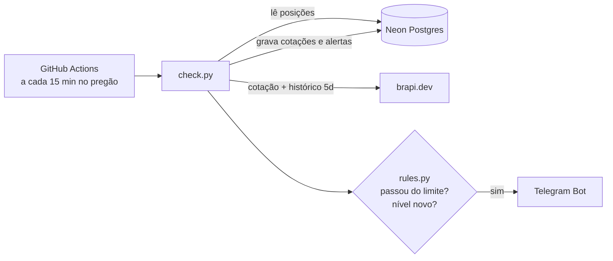

# 📈 Alerta de Investimentos

[](https://github.com/FelipeZina/alerta-investimentos/actions/workflows/ci.yml)
[](https://github.com/FelipeZina/alerta-investimentos/actions/workflows/check.yml)


Sistema que monitora ações da B3 durante o pregão e envia alertas no **Telegram** quando uma delas sobe ou cai além de um limite, mostrando também o resultado da sua posição com base no preço médio de compra.

Roda 100% na nuvem e de graça: **GitHub Actions** agenda as verificações, **brapi.dev** fornece as cotações e **Neon** (Postgres serverless) guarda o histórico.

```
🔻 ITUB4 caiu 4,20% hoje (passou de 3%)
Preço: R$ 36,10 | fech. ant. R$ 37,68
Sua posição: 100 cotas · PM R$ 28,90 · +24,91% (+R$ 720,00)
```

## Como funciona



1. O workflow `check.yml` roda a cada 15 minutos, de segunda a sexta, das 10h às 17h45 (horário de Brasília).
2. As ações monitoradas são as cadastradas na tabela `positions` (ticker, quantidade e preço médio).
3. Para cada ação, a cotação é buscada na brapi e gravada na tabela `quotes`.
4. A variação do dia é classificada em **níveis**: com limite de 3%, -4% é nível 1 e -7% é nível 2.
5. O alerta só é enviado quando o nível **sobe** em relação ao que já foi alertado naquele pregão. Assim a mesma queda não gera uma mensagem a cada 15 minutos, mas uma piora relevante gera um alerta novo.

## Decisões técnicas

- **Data real do pregão:** o campo `regularMarketTime` da brapi é o horário de *atualização* do dado, e não do pregão. Em feriados e antes da abertura, a API continua devolvendo a variação do último pregão, o que geraria alertas falsos. A data do pregão é inferida comparando os candles diários com o fechamento anterior ([`infer_trade_date`](src/alerta/brapi.py)).
- **Anti-spam garantido pelo banco:** `UNIQUE (ticker, trade_date, direction, level)` na tabela `alerts`. O alerta é gravado só **depois** do envio: se o Telegram falhar, a próxima execução tenta de novo.
- **`Decimal`/`NUMERIC` para dinheiro:** nada de `float` em valores financeiros.
- **Regras como funções puras:** [`rules.py`](src/alerta/rules.py) não acessa rede nem banco, então é testado sem mocks.
- **Segurança:** o token vai no header, e não na URL. O logger do `httpx` é silenciado porque a URL do Telegram contém o token do bot e os logs de um repositório público são públicos. As actions de terceiros são fixadas por SHA, e os workflows têm permissão somente de leitura.
- **Migrations versionadas:** SQL puro em [`migrations/`](migrations/), aplicadas por um runner simples que registra o que já rodou em `schema_migrations`.

## Stack

| Camada | Ferramenta |
|---|---|
| Linguagem | Python 3.12 |
| Dependências | [uv](https://docs.astral.sh/uv/) |
| HTTP | httpx |
| Validação / config | pydantic, pydantic-settings |
| Banco | PostgreSQL ([Neon](https://neon.tech)), psycopg 3 |
| Cotações | [brapi.dev](https://brapi.dev) |
| Notificações | Telegram Bot API |
| Testes | pytest, respx (mock de HTTP), Postgres real no CI |
| Qualidade | ruff (lint + format) |
| Automação | GitHub Actions (CI + cron) |

## Rodando o seu

### 1. Pré-requisitos
- **Token da brapi:** crie uma conta em [brapi.dev](https://brapi.dev). O plano gratuito permite 15 mil requisições por mês, com cotações atrasadas em ~30 min.
- **Bot do Telegram:**
  - Fale com o [@BotFather](https://t.me/BotFather), envie `/newbot` e guarde o token.
  - Abra o seu bot, toque em **Iniciar** e mande uma mensagem qualquer.
  - Acesse `https://api.telegram.org/bot<TOKEN>/getUpdates` e copie o `chat.id`.
- **Banco no Neon:** crie um projeto em [neon.tech](https://neon.tech) e copie a connection string **sem pooling**.
- **uv:** instale seguindo [a documentação](https://docs.astral.sh/uv/getting-started/installation/).

### 2. Instalação local
```bash
git clone https://github.com/<seu-usuario>/alerta-investimentos.git
cd alerta-investimentos
uv sync
cp .env.example .env              # preencha com seus valores
uv run python -m alerta.migrate   # cria as tabelas
```

### 3. Cadastre suas posições
No SQL Editor do Neon (ou no seu cliente SQL favorito):
```sql
INSERT INTO positions (ticker, quantity, avg_price) VALUES
    ('PETR4', 100, 32.50),
    ('ITUB4',  50, 28.90);
```

### 4. Teste local
```bash
uv run python -m alerta.check --dry-run            # mostra os alertas sem enviar nem gravar
uv run python -m alerta.check --dry-run --any-day  # processa mesmo fora do pregão
uv run python -m alerta.check                      # execução real
```

### 5. Automatize com GitHub Actions
1. Faça um fork deste repositório.
2. Em **Settings → Secrets and variables → Actions**, crie os secrets `BRAPI_TOKEN`, `TELEGRAM_BOT_TOKEN`, `TELEGRAM_CHAT_ID` e `DATABASE_URL`.
3. Opcional: crie a variable `ALERT_THRESHOLD_PCT` para mudar o limite padrão de 3%.
4. Na aba **Actions**, habilite os workflows. Em forks eles vêm desativados.
5. Teste com **Actions → Check → Run workflow**, marcando `dry_run`.

## Desenvolvimento

```bash
uv run ruff format .     # formata
uv run ruff check .      # lint
uv run pytest            # testes (os de banco são pulados sem TEST_DATABASE_URL)
TEST_DATABASE_URL=postgresql://... uv run pytest   # inclui testes de integração
```

Os testes de banco rodam cada caso dentro de uma transação desfeita no final, então não deixam dados para trás. No CI eles rodam contra um Postgres temporário criado pelo próprio GitHub Actions.

Feito por [Felipe Zina](https://github.com/FelipeZina).
